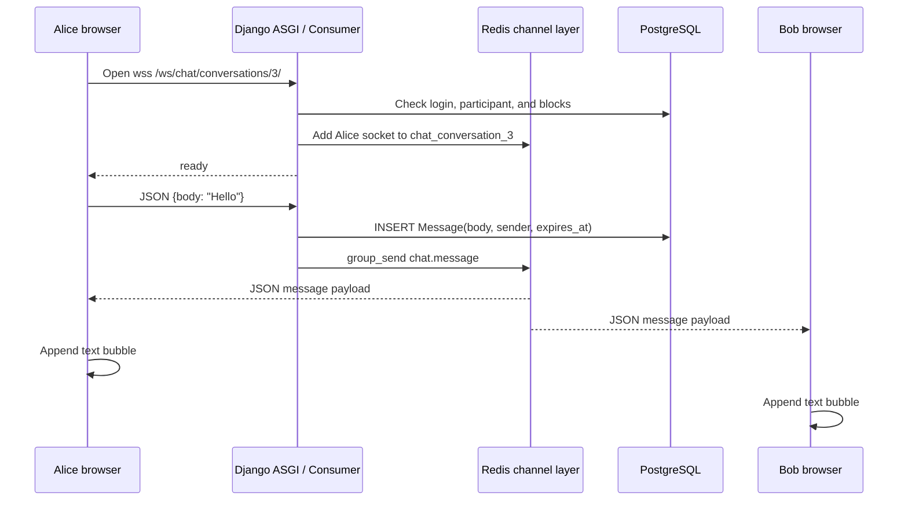
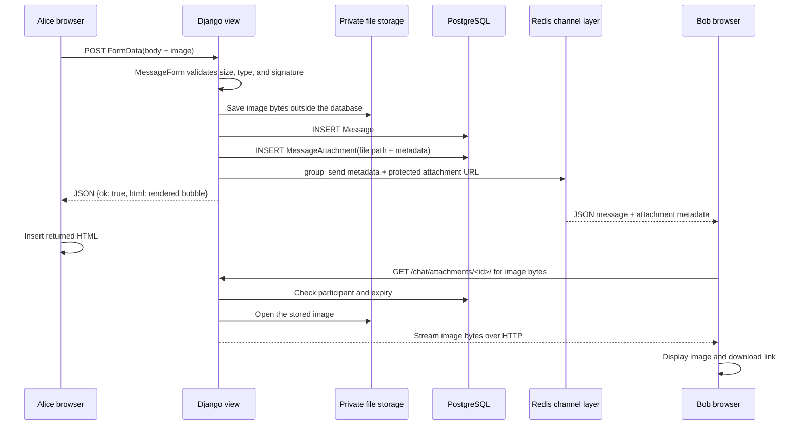

# Chat Lab: How Text and Image Messages Travel

This is the data-flow lesson for Lesson 23. Text and image attachments use
different transport paths, but they become one `Message` in the database and
one live event in the conversation channel.

## The three places involved

| Place | Responsibility |
| --- | --- |
| Browser | Collects text or a file, sends the request, and renders the new bubble |
| Django | Checks identity and permissions, validates input, and saves the message |
| PostgreSQL + file storage | PostgreSQL stores message metadata; storage keeps image bytes |

Redis is an additional delivery layer. It does not replace PostgreSQL and it
does not store the image file.

## Text flow: WebSocket first



The browser code in `chat/static/chat/message_send.js` calls
`window.chatRealtimeSend(body)`. That sends JSON through the already-open
WebSocket instead of submitting the whole page.

`ConversationConsumer.receive_json()` then:

1. Trims and validates the text.
2. Checks that the user still belongs to the conversation and is not blocked.
3. Creates a durable `Message` row in PostgreSQL.
4. Sends a `chat.message` event to the conversation group.

Channels maps the event type `chat.message` to the Python method
`chat_message()`. Every connected browser in that group receives the same safe
metadata payload. `message_realtime.js` creates the bubble with DOM methods and
text nodes.

## Image flow: HTTP file upload, then WebSocket notification

The image itself does **not** travel through Redis or the WebSocket. A browser
file upload is multipart data, so we keep it on the existing HTTP path.



The exact sequence is:

1. `message_send.js` notices that a file is selected. It does not call the
   text-only WebSocket function.
2. It sends `FormData` to `conversation_detail` with the `X-Chat-Async: 1`
   header.
3. `MessageForm` validates the upload: maximum size, extension, MIME type, and
   file signature.
4. The view saves a `Message` row and a `MessageAttachment` row in one
   transaction. The `file` field stores a path; the image bytes go to the
   configured file storage.
5. `_broadcast_message()` builds metadata with `message_payload()` and sends
   it to the same Redis conversation group. The payload contains the attachment
   ID, filename, content type, and protected URL. It does not contain binary
   image data.
6. Alice receives the HTTP response and inserts the server-rendered HTML.
   Bob receives the WebSocket event and `message_realtime.js` creates an image
   element and download link.
7. Bob's browser makes a normal HTTP GET for the image URL. The attachment
   view checks authentication, conversation membership, message expiry, and
   attachment expiry before streaming the bytes.

The sender can receive both the HTTP response and the broadcast event. The
rendered HTML includes `data-message-id`, so the browser ignores the live
duplicate instead of showing the message twice.

### Why the race happens

The two paths run independently:

```text
save message
   ├─ broadcast WebSocket event ──> sender may render first
   └─ return HTTP response       ──> sender may render second
```

Network timing decides which arrives first. The message ID is generated once
by the database, so both paths can compare the same ID. Before inserting the
HTTP response HTML, `message_send.js` checks for that ID; the live-message code
performs the same check before appending a WebSocket event.

## What is stored where?

```text
Message
  id, conversation_id, sender_id, body, created_at, expires_at

MessageAttachment
  id, message_id, file="chat_attachments/<random-name>.png"
  original_name, content_type, size_bytes, expires_at

File storage
  actual PNG/JPEG/WebP bytes

Redis
  temporary channel-group events used to notify connected sockets
```

PostgreSQL remains the source of truth. If Redis is unavailable, the message
can still be saved through HTTP; the recipient may need to refresh. If a file
is missing, the attachment route returns `404` rather than exposing another
user's file.

## Why the image is not sent inside the WebSocket

WebSockets can carry binary frames, but using them for this upload would make
the lesson harder to secure and validate. The current split gives each tool a
clear job:

- HTTP multipart handles file size limits, content validation, storage, and
  retryable upload errors.
- WebSocket handles tiny, fast notifications.
- Redis distributes those notifications when more than one web process exists.
- PostgreSQL records the durable message and permission relationships.

This is why an image can appear instantly in Bob's conversation even though the
image bytes arrive through a separate HTTP request a moment later.

## Expiry behavior

The database stores the message and attachment deadlines. The browser starts a
timer when a bubble appears and removes it when the message expires. The
protected attachment route also checks expiry, so an old image cannot be
downloaded just by keeping its URL. A cleanup command later deletes expired
database rows and files physically.

## Local test that exposes the whole flow

1. Start the Chat Lab ASGI server.
2. Open one conversation in two browser windows.
3. Sign in as Alice in one and Bob in the other.
4. Send plain text and watch the WebSocket message arrive.
5. Send an image with a caption and watch Bob's window receive the attachment
   bubble without clicking **Latest messages**.
6. Open the browser Network panel. You will see:
   - a WebSocket frame containing message metadata;
   - a separate HTTP request for `/chat/attachments/<id>/` when the image loads.

That separation is the core architecture of this Chat Lab.

## Optional polish still remaining

- Durable profile and attachment storage through object storage or a paid disk.
- Reconnect backoff when the WebSocket drops.
- Typing indicators, online status, and read receipts.
- UI and accessibility polish.
